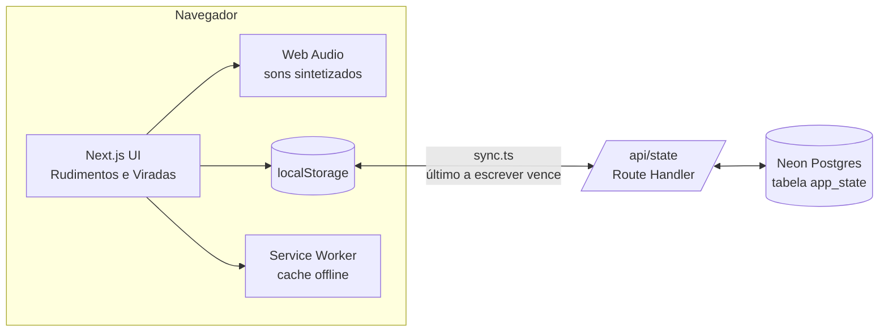
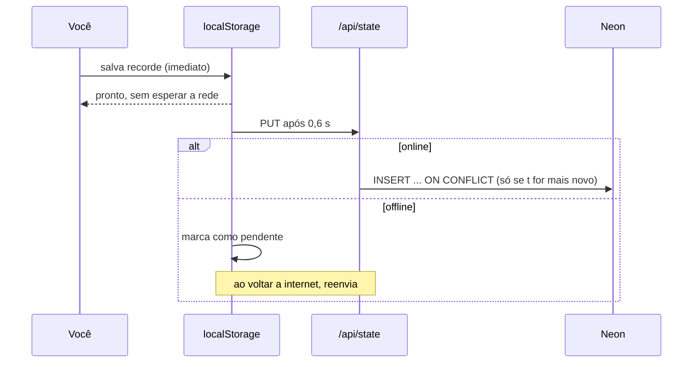

<div align="center">

# 🥁 40 Rudimentos

**Treine rudimentos e viradas de bateria com metrônomo, loop e velocidade progressiva.**
Instalável como app, funciona offline e sincroniza seu progresso na nuvem.


</div>

---

## ✨ O que tem aqui

| | Recurso | Detalhes |
|---|---|---|
| 🥁 | **40 rudimentos** | Rolls, Paradiddles, Flams e Drags, com a sequência de mãos **D / E** e ornamentos (flam/drag) em tamanho menor |
| ⏱️ | **Metrônomo e loop** | BPM de 40 a 220, subdivisão em colcheias, tercinas ou semicolcheias, com a nota atual destacada |
| 🏆 | **Recordes e domínio** | Salve o melhor BPM de cada rudimento e marque os que já domina (`X/40`) |
| 🎛️ | **Criador de viradas** | Grade por peças da bateria, 16 passos, com mão D/E por passo |
| 📈 | **Velocidade progressiva** | Acelerar, desacelerar ou subir e descer o BPM a cada X loops, entre um mínimo e um máximo |
| 🔊 | **Sons por mão** | Direita mais aguda e à direita, esquerda mais grave e à esquerda (melhor com fone) |
| 📲 | **PWA** | Instalável, abre offline, com botão de instalar e aviso de nova versão |
| ☁️ | **Sync com Neon** | Offline-first: grava local na hora e sincroniza com o Postgres quando há internet |

---

## 🎛️ O criador de viradas

Cada coluna é uma semicolcheia (4 tempos no total). Toque numa peça para colocar a nota naquele passo; a linha do topo mostra a mão. O **bumbo** é tocado com o pé e aparece como **K**.

```text
         D   E   D   E   D   E   D   E  ...   ← mãos (toque para trocar)
         1       .       2       .
  CR    ·   ·   ·   ·   ·   ·   ·   ·
  HH    ·   ·   ·   ·   ·   ·   ·   ·
  T10  [D] [E]  ·   ·   ·   ·   ·   ·
  T12   ·   ·  [D] [E]  ·   ·   ·   ·
  S14   ·   ·   ·   ·  [D] [E]  ·   ·
  CX    ·   ·   ·   ·   ·   ·   ·   ·
  K     ·   ·   ·   ·   ·   ·  [K] [K]
```

**Modos de velocidade**

| Modo | O que faz |
|---|---|
| Fixa | Mantém o BPM |
| Acelerar | Sobe `passo` BPM a cada `N` loops, até o máximo |
| Desacelerar | Desce até o mínimo |
| Sobe e desce | Vai e volta entre o mínimo e o máximo |

---

## 🧱 Arquitetura



### 🔄 Como o sync funciona



- **Offline-first:** o app nunca espera a rede para responder.
- **Conflitos:** cada gravação carrega um timestamp `t`; o Neon só aceita se for mais novo que o que já está lá.
- **Acesso:** a API exige o header `x-app-key`, igual à `APP_KEY` do servidor.

---

## 📂 Estrutura

```text
.
├── app/
│   ├── page.tsx                  # abas: Rudimentos / Viradas
│   ├── layout.tsx                # metadados do PWA
│   ├── manifest.ts               # manifest (nome, ícones, cores)
│   ├── rudimentos.css            # estilos, tema claro/escuro automático
│   ├── api/state/route.ts        # GET/PUT do estado no Neon
│   ├── components/
│   │   ├── RudimentPlayer.tsx    # player, lista e recordes
│   │   ├── FillBuilder.tsx       # criador de viradas
│   │   └── RegisterSW.tsx        # service worker, instalar e atualizar
│   └── lib/
│       ├── data.ts               # os 40 rudimentos, peças e tipos
│       ├── audio.ts              # sons (Web Audio API)
│       ├── useLoop.ts            # scheduler de loop com BPM em tempo real
│       └── sync.ts               # localStorage ⇄ Neon
├── public/
│   ├── sw.js                     # service worker
│   └── icon-192.png / icon-512.png
├── db/schema.sql                 # tabela app_state
└── .env.example                  # modelo das variáveis
```

---

## 🚀 Como rodar

**Pré-requisitos:** Node.js 20+ e uma conta no [Neon](https://neon.tech) (plano gratuito serve).

```bash
# 1. dependências
npm install
npm i @neondatabase/serverless

# 2. variáveis de ambiente
cp .env.example .env.local
#    edite o .env.local (veja abaixo)

# 3. desenvolvimento
npm run dev
```

Abra <http://localhost:3000>.

### 🔐 Variáveis de ambiente

| Variável | De onde vem |
|---|---|
| `DATABASE_URL` | Neon → **Connect** → connection string com *Connection pooling* ligado (`sslmode=require`) |
| `APP_KEY` | Uma chave longa que você inventa. O app pede uma vez no navegador |

> ⚠️ O `.env.local` **nunca** deve ir para o Git (o `.gitignore` do Next já ignora `.env.*`). Se a senha vazar, use **Reset password** no Neon.

### 🗄️ Banco

A API cria a tabela sozinha na primeira chamada. Se preferir criar antes, rode o `db/schema.sql` no **SQL Editor** do Neon:

```sql
CREATE TABLE IF NOT EXISTS app_state (
  key   text   PRIMARY KEY,   -- "progress" | "fill"
  value jsonb  NOT NULL,
  t     bigint NOT NULL
);
```

Para conferir o que foi salvo: `SELECT key, t FROM app_state;`

---

## 📲 PWA

O service worker só é registrado em **produção**, para não atrapalhar o desenvolvimento.

```bash
npm run build && npm start
```

| Plataforma | Como instalar |
|---|---|
| Chrome / Edge (PC e Android) | Botão **Instalar app** na barra do próprio site |
| iPhone (Safari) | **Compartilhar → Adicionar à Tela de Início** |

- 📴 **Offline:** depois da primeira visita, o app abre sem internet (estratégia *network-first* com cache de fallback; `/api` nunca é cacheado).
- 🔄 **Atualizações:** quando há versão nova aparece o aviso **Atualizar**; o app procura novidades de hora em hora.
- 🧪 **Para depurar:** DevTools → **Application** → *Manifest* e *Service Workers*; marque **Offline** e recarregue.

---

## ☁️ Deploy (Vercel)

1. Suba o projeto para o GitHub (sem o `.env.local`).
2. Importe o repositório na [Vercel](https://vercel.com).
3. Em **Settings → Environment Variables**, cadastre `DATABASE_URL` e `APP_KEY`.
4. Faça o deploy e abra a URL no celular para instalar.

---

## 🔊 Sobre os sons

Não há arquivos de áudio: tudo é sintetizado pela **Web Audio API** (osciladores e ruído filtrado).

- **Mão direita (D):** tom mais agudo, deslocado para a direita.
- **Mão esquerda (E):** tom mais grave, deslocado para a esquerda.
- **Bumbo (K):** sempre no centro.
- **Metrônomo:** clique mais agudo no primeiro tempo.

---

## 🗺️ Ideias para o futuro

- [ ] Biblioteca de viradas com nome (salvar várias)
- [ ] Compassos de 2 ou 3 tempos e notas simultâneas (bumbo com prato)
- [ ] Gráfico de evolução do BPM por rudimento
- [ ] Metrônomo avulso, sem padrão tocando
- [ ] Login de verdade (Auth.js) para uso com mais pessoas

---

## ⚠️ Avisos

- Projeto de **uso pessoal e estudo**, inspirado no conceito de apps de treino de rudimentos. Não tem vínculo com os apps originais e não reutiliza o código ou o conteúdo deles.
- Os stickings seguem o padrão dos 40 rudimentos de forma geral; alguns mais complexos (como Flamacue, Lesson 25 e os Drag Paradiddles) merecem conferência com seu professor ou com material de referência.
- O **Multiple Bounce Roll** toca como double stroke, sem o efeito de *buzz*.

<div align="center">

Feito para estudar bateria 🥁 — bons treinos!

</div>
